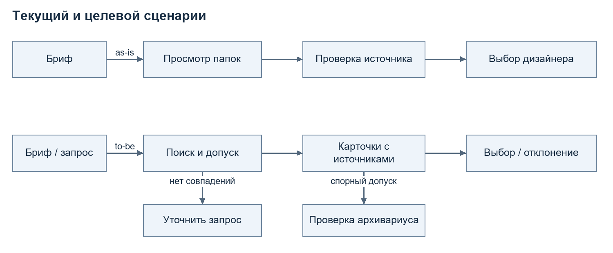

# Лабораторная работа 1

## Project Brief проблема и ценность

Методические указания по дисциплине «Проект — применение машинного обучения в креативных технологиях». Магистратура, второй курс, первый семестр курса (третий семестр обучения).

Связь с лекциями: Лекция 1. Компетенции и индикаторы: ПК-1, ПК-3.

## Цель

Выбрать предметную область и сформулировать проверяемую проблему, для которой применение ML или инженерии знаний действительно оправдано.

## Исходная ситуация

Команда выбирает один трек: анализ медиа, поиск/рекомендации, генеративный ассистент или мультимодальный сервис. Допустимый кейс: сервис помогает дизайнеру найти в личном архиве референсы для плаката по смысловому запросу.

Вход для работы: согласуемая идея проекта. Результат включается в портфолио и используется на следующих шагах.

## Подготовка к работе

Выберите одного основного пользователя и одну рабочую ситуацию. Для начала достаточно наблюдения за текущим действием или краткого разговора с будущим пользователем. Если такого контакта ещё нет, оформите предположения команды и запланируйте их проверку в ЛР 2. Название нейросети, библиотеки или API не является описанием потребности.

Project Brief связывает проблему, ожидаемую пользу, границы и план проверки. Его читают и разработчик, и преподаватель, и возможный заказчик. Поэтому по этому документу должно быть понятно, что именно изменится для человека. Стейкхолдером называют любую сторону, чьи интересы затрагивает решение. Автор исходной фотографии может не пользоваться сервисом, но его интересы всё равно необходимо учитывать.

Полезность для дизайнера и качество модели измеряются по-разному. Время до выбора подходящего референса характеризует пользовательский сценарий. NDCG характеризует порядок кандидатов в выдаче. Высокая NDCG не доказывает экономию времени: карточки могут медленно открываться, а статус прав — быть непонятным. На этой работе определите продуктовую пользу; точную техническую спецификацию вы разработаете в ЛР 3 и 8.

## Развёрнутый порядок выполнения

### Шаг 1 Пользователь и наблюдаемая проблема

Запишите роль, рабочую ситуацию, текущее действие и конкретное затруднение. Плохая постановка — «дизайнерам нужен ИИ». Проверяемая постановка — «при подготовке афиши дизайнер ищет в папках подходящие композиции, но названия файлов не позволяют найти работы по краткому описанию». Рядом укажите источник: наблюдение, слова пользователя или гипотеза команды. Пока нет измерений, не называйте оценку времени установленным фактом.

### Шаг 2 Проверяемое целевое изменение

Сформулируйте «было → стало» и выберите событие, по которому можно заметить успех. Укажите начало и конец измерения. Например, отсчёт начинается после выдачи задания и заканчивается, когда дизайнер выбрал карточку и объяснил её релевантность. Запишите целевое время как гипотезу. Предусмотрите неуспех: отсутствие подходящих карточек, слишком длинный поиск или неприемлемые условия использования материала.

### Шаг 3 Карта заинтересованных сторон

Для каждой роли укажите интерес, влияние на решение и потенциальное противоречие. Дизайнеру нужна широкая выдача, архивариусу — только проверенные материалы. Разрешение конфликта должно быть видно в сценарии: сомнительная карточка не предлагается к использованию, а передаётся на проверку. Не заменяйте карту списком имён участников команды.

### Шаг 4 Границы первой версии

Перечислите входы и выходы, доступные данные, поддерживаемые действия и действия вне проекта. Отдельно назовите решения человека. Для генеративного ассистента таким решением будет утверждение черновика перед публикацией. Для поиска — выбор референса и проверка допустимости его использования. Составьте список неизвестного: права на архив, качество описаний, доступность эксперта.

### Шаг 5 Сравнение способов решения

Сопоставьте минимум два подхода на одинаковой задаче. Укажите данные, затраты, ограничения и способ проверки каждого. Простой поиск по словам обязательно включите в сравнение: он может оказаться достаточным. Обоснуйте, какая неопределённость требует более сложного подхода. Для смыслового поиска это разнообразие формулировок; для автоматической разметки — невозможность описать все визуальные варианты коротким правилом.

### Шаг 6 Сценарии и репозиторий

Нарисуйте текущую и будущую последовательности действий, включая неуспех и ручное решение. Подготовьте бриф на 2–3 страницы, карту, сравнение и репозиторий. В README укажите тему, авторов, состояние проекта и навигацию. Проверьте доступ преподавателя, затем согласуйте трек. В демо используется действующий репозиторий курса; студент создаёт собственный и не выдаёт учебный образец за свой вклад.

## Полный демонстрационный вариант

Сквозной кейс — «Визуальный навигатор», помощник дизайнера при поиске референсов. Число 1 200 характеризует условный будущий архив в постановке. Запускаемое демо содержит 42 исходные записи и 36 уникальных разрешённых учебных макетов после очистки. Нельзя подменять проверку большой коллекции результатами на этих 36 объектах.

### Артефакт Project Brief

# Визуальный навигатор

## Проблема и пользователь

Основной пользователь — дизайнер небольшой студии, который перед созданием афиши собирает референсы из собственного архива. В рассматриваемом сценарии он получает краткий бриф о событии, открывает папки с работами, просматривает изображения и вручную формирует подборку. Проблема возникает, когда нужная работа описана другими словами или находится в неожиданной папке. Поиск по памяти затрудняет повторное использование коллекции и делает результат зависимым от знакомства с архивом.

Оценка «20–30 минут на поиск в архиве из 1 200 работ» является исходной гипотезой кейса. Интервью с реальными дизайнерами и замеры ещё не проводились. Для проверки команда должна наблюдать текущий процесс и отдельно фиксировать просмотр, уточнение запроса и проверку источника. Затруднение считается подтверждённым, если пользователи действительно теряют время на поиск уже имеющихся материалов, а не на согласование творческой идеи.

## Ценность и критерии успеха

Предполагаемое изменение: вместо последовательного просмотра папок дизайнер вводит описание и получает короткий список кандидатов. Он сохраняет право отвергнуть выдачу, уточнить запрос и самостоятельно выбрать материал. Ценность состоит в сокращении времени подбора при сохранении авторского контроля, а не в самом факте использования машинного обучения.

Целевые ориентиры первой пользовательской проверки: ответ сервиса не дольше 10 секунд и первый обоснованный выбор референса не дольше 5 минут. Это цели, а не полученные результаты. При сравнении текущего и нового способов нужны равноценные задания и фиксация помощи модератора. Если подходящих материалов в архиве нет, корректным результатом может быть сообщение об отсутствии совпадений. Оно не должно превращаться в случайную уверенную рекомендацию.

## Участники и ответственность

Дизайнер проверяет соответствие творческому брифу. Архивариус подтверждает происхождение и допустимость материалов. Руководитель студии определяет ресурсные границы. Автор исходного контента заинтересован в соблюдении условий использования. Команда разработки отвечает за воспроизводимость поиска, отображение ограничений и исправление технических ошибок. Преподаватель согласует учебную тему и оценивает доказательность решений.

## Данные и границы alpha

Вход — текстовый запрос на русском языке длиной до 300 символов. Выход — до трёх карточек в техническом демо с источником, статусом разрешения и оценкой сходства. В продуктовом сценарии допускается до десяти кандидатов, но увеличение числа выдаваемых карточек требует отдельной проверки удобства. Alpha не генерирует афиши, не публикует контент, не подтверждает права и не передаёт закрытые архивы внешним сервисам.

Для воспроизводимого учебного примера созданы геометрические макеты и текстовые описания. После очистки остаются 36 карточек шести жанров. Это искусственно простой набор, а его разметка не является результатом экспертного исследования. Реальный архив можно подключать только после проверки источников, разрешений и качества метаданных. Неизвестный статус прав блокирует выдачу материала до уточнения архивариусом.

## Альтернативы и предварительный выбор

Первый вариант — папки, ручные теги и поиск точных слов. Он прост, объясним и не требует обучения. Второй — TF-IDF-поиск по описаниям с проверяемым словарём предметных синонимов. Он позволяет показать связь статистического представления текста и инженерии знаний без внешнего API. Третий, перспективный вариант — поиск по нейросетевым представлениям текста и изображения, требующий отдельной оценки модели, ресурсов и допустимости использования.

Для alpha выбран второй вариант. Его проверяемая гипотеза: нормализация известных предметных синонимов улучшит ранжирование соответствующих запросов по сравнению с тем же TF-IDF без словаря. Это локальная гипотеза, не обещание понимания любого творческого брифа. Словарь не решает проблему новых языков, отрицания и сложных композиций. При его недоступности используется исходный поиск, а режим fallback явно обозначается пользователю.

## План проверки и условия пересмотра

Сначала команда уточняет знания о домене и критерии релевантности, затем готовит данные, baseline и контролируемый эксперимент. Решение о включении словаря принимается по validation; итоговая контрольная оценка проводится на test после фиксации метода. Пользовательская полезность проверяется отдельно в ЛР 15. Если улучшение метрик не приводит к удобному выбору, следует исследовать интерфейс и содержание карточек.

Тему необходимо пересмотреть, если нет допустимых данных, ключевая проблема не подтверждается наблюдением или простой поиск решает задачу не хуже. Открытые вопросы: реальная длительность поиска, разнообразие формулировок, надёжность описаний, правила допуска контента. Следующий шаг — протокол извлечения знаний из ЛР 2. Репозиторий учебного образца: https://github.com/Irina-64/ml-creative-technologies-course.

### Артефакт Карта стейкхолдеров

| Сторона | Интерес и влияние | Конфликт и принятое решение |
|---|---|---|
| Дизайнер | Быстрый поиск и право выбора; оценивает полезность | Широкая выдача против ограничений: показывать только допущенные карточки |
| Архивариус | Происхождение и разрешения; блокирует сомнительные материалы | Скорость против проверки: отдельная очередь эскалации |
| Автор контента | Соблюдение условий использования | Удобство копирования против авторского контроля: источник виден всегда |
| Руководитель | Время и стоимость; задаёт ресурсы | Автоматизация против качества: alpha сохраняет решение человека |
| Разработчики | Поддерживаемость и воспроизводимость | Сложность модели против срока: локальный TF-IDF и словарь |
| Преподаватель | Проверяемый учебный результат | Демонстрация против реального доказательства: отдельная маркировка симуляций |

### Артефакт Сценарии

As-is: бриф → выбор папок → ручной просмотр → проверка источника → подборка → решение дизайнера. Если материал не найден, дизайнер повторяет просмотр или ищет вне архива.

To-be: бриф → проверка длины запроса → поиск по описаниям → проверка допуска карточек → выдача с источниками → выбор или отклонение → сохранение обратной связи. Пустая выдача приводит к уточнению запроса. Неизвестные права приводят к эскалации. Отказ улучшенного поиска включает baseline с явным статусом fallback.

### Артефакт Сравнение альтернатив

| Подход | Данные и трудоёмкость | Ограничение | Как сравнить |
|---|---|---|---|
| Папки и точные слова | Названия и теги; ручная поддержка | Синонимы не связаны | Одинаковые брифы и время до выбора |
| TF-IDF и словарь | Описания, train-корпус, проверенные соответствия | Новые слова и языки | NDCG на тех же validation-запросах |
| Нейросетевые представления | Модель и индекс, проверка ресурсов | Стоимость, права, сложность объяснения | Отдельный последующий эксперимент |

Выбор: второй подход как проверяемая учебная alpha. При удалении словаря сохраняется работающий baseline. При удалении всего ранжировщика остаётся ручной просмотр, позволяющий проверить, действительно ли автоматизация даёт пользу.

### Артефакт Созданный репозиторий

Действительный адрес учебного комплекта: https://github.com/Irina-64/ml-creative-technologies-course. В нём `labs/01/demo/` содержит заполненные документы, `demo/` — запускаемый проект, `source_prompts/01.md` — исходное задание. Для сдачи своей работы укажите собственный репозиторий, ветку или commit, авторов изменений и предоставьте доступ преподавателю. Подмена адреса на выдуманную ссылку недопустима.

### Проверка демо по критериям

Пользователь и контекст зафиксированы в первом разделе брифа. Польза выражена временем и действием, а не названием модели. Сравнение связывает метод с разнообразием формулировок. Раздел о границах содержит ограничения до реализации. Гипотезы о времени не выдаются за результаты измерений. Отдельный двухстраничный образец брифа находится рядом с методичкой.

## Что сдать

Project Brief объёмом 2–3 страницы; карта стейкхолдеров; схема «as-is / to-be»; таблица сравнения альтернатив; ссылка на созданный репозиторий.

Пути ниже указаны относительно папки demo данной ЛР, если не приведён полный адрес.

| Требуемый материал | Где находится выполненный образец |
|---|---|
| Project Brief на 2–3 страницы | project_brief.docx |
| Карта стейкхолдеров | stakeholders.md |
| Схема as-is / to-be | scenarios.md |
| Сравнение альтернатив | alternatives.md |
| Ссылка на репозиторий | https://github.com/Irina-64/ml-creative-technologies-course |

## Критерии приёмки

Пользователь и контекст конкретны; ценность не подменена названием технологии; выбранный подход связан с характером данных или знаний; ограничения сформулированы до реализации.

| Критерий | Свидетельство в демо |
|---|---|
| Пользователь и контекст конкретны | Первый раздел Project Brief |
| ценность не подменена названием технологии | Раздел о ценности и измерении времени |
| выбранный подход связан с характером данных или знаний | Сравнение альтернатив и выбор TF-IDF со словарём |
| ограничения сформулированы до реализации | Раздел о границах alpha |

## Типичные ошибки

«Сделать нейросеть для дизайна» вместо описания проблемы; слишком широкий рынок; метрика «accuracy» как единственный критерий пользовательской ценности; обещание полной автоматизации там, где нужен авторский контроль.

## Самопроверка перед сдачей

Может ли другой студент объяснить проблему, не зная выбранной библиотеки? Что произойдёт, если выбранный ML-компонент убрать из решения?

На индивидуальной защите объясните одно своё решение, покажите его артефакт и назовите ограничение. Учебный демо-вариант служит образцом оформления; собственный проект требует собственных данных, решений и подтверждённого вклада.

## Материалы и источники

https://github.com/Irina-64/ml-creative-technologies-course/tree/main/labs/01

Исходное задание сохранено в source_prompts/01.md. Формулировки компетенций приведены в COURSE_BASIS.md.

## Исходные шесть требований к выполнению

1. Опишите пользователя, ситуацию применения, его текущее действие и наблюдаемую трудность. Не начинайте с названия модели или сервиса.

2. Сформулируйте целевое изменение в виде «было → стало» и укажите, как будет замечено улучшение.

3. Выделите заказчика, пользователя, автора контента, разработчика и иные значимые стороны; зафиксируйте их возможные конфликтующие интересы.

4. Опишите границы: что первая версия делает, чего не делает, какими данными располагает и какие способы применения запрещены.

5. Сравните минимум две альтернативы: правило или обычную автоматизацию и вариант с ML/инженерией знаний. Укажите, какая неопределённость оправдывает выбранный подход.

6. Подготовьте схему текущего и целевого сценария, затем согласуйте тему и трек с преподавателем.
