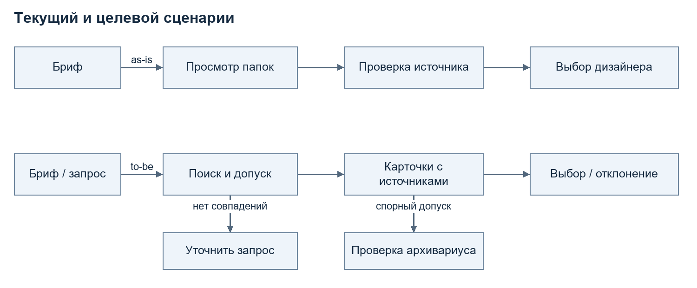

As-is: бриф → выбор папок → ручной просмотр → проверка источника → подборка → решение дизайнера. Если материал не найден, дизайнер повторяет просмотр или ищет вне архива.

To-be: бриф → проверка длины запроса → поиск по описаниям → проверка допуска карточек → выдача с источниками → выбор или отклонение → сохранение обратной связи. Пустая выдача приводит к уточнению запроса. Неизвестные права приводят к эскалации. Отказ улучшенного поиска включает baseline с явным статусом fallback.
