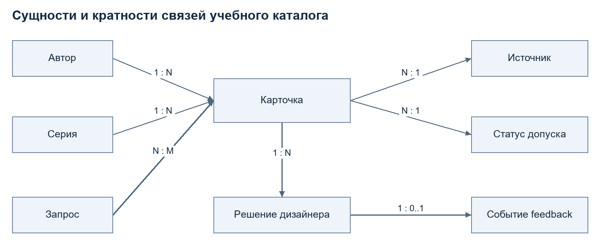

# Лабораторная работа 2

## Извлечение знаний о предметной области

Методические указания по дисциплине «Проект — применение машинного обучения в креативных технологиях». Магистратура, второй курс, первый семестр курса (третий семестр обучения).

Связь с лекциями: Лекции 1–2. Компетенции и индикаторы: ПК-3, ПК-3.1.

## Цель

Получить и зафиксировать знания предметной области, необходимые для проектирования решения и проверки его результатов.

## Исходная ситуация

Для сервиса поиска референсов знаниями могут быть жанры, назначение плаката, правила композиции, авторские ограничения и критерии релевантности для дизайнера.

Вход для работы: артефакты предыдущих работ, прежде всего ЛР 1. Результат включается в портфолио и используется на следующих шагах.

## Что нужно понять до начала

Знания предметной области помогают решить, что считать подходящим референсом, как различать жанры и какие случаи нельзя автоматизировать. Интервью отвечает на вопросы о практике, наблюдение показывает действия, документ фиксирует правила. Каждый метод имеет ограничения: слова эксперта могут расходиться с поведением, а старый регламент — с актуальными условиями.

Различайте факт наблюдения, мнение, интерпретацию и гипотезу. Фраза «участник три раза изменил запрос» описывает наблюдение. Фраза «поиск неудобен» является интерпретацией. Связывайте каждое правило с источником и статусом проверки. Иначе ошибочное мнение незаметно превращается в код и распространяется на всех пользователей.

## Развёрнутый порядок выполнения

### Шаг 1 План извлечения знаний

Возьмите проблему из ЛР 1 и запишите, каких знаний не хватает для проектирования. Для поиска референсов нужны критерии релевантности, словарь запросов и правила допуска карточек. Выберите информантов по их роли, подготовьте вопросы о последнем реальном случае, согласуйте запись и обезличивание. План должен объяснять, какое проектное решение зависит от ответа.

### Шаг 2 Получение двух источников

Проведите минимум два интервью, наблюдения или анализа достоверных документов. Не задавайте наводящий вопрос «вам ведь нужен ИИ?». Просите показать конкретное действие или разобрать карточку. Если экспертов нет, заранее согласуйте замену с преподавателем. Учебная симуляция ниже объясняет оформление, но сама по себе не заменяет этот пункт студенческой сдачи.

### Шаг 3 Разделение записей и выводов

Сначала сохраните краткую запись с указанием источника и контекста. Рядом отдельно поместите интерпретацию и решение команды. Противоречия не стирайте: они показывают, какие случаи требуют дополнительного вопроса. Не записывайте фамилии и контактные данные, если для анализа достаточно кода роли.

### Шаг 4 Глоссарий

Соберите 15–20 терминов именно выбранного домена. Для каждого дайте определение через признаки, пример и источник. Определение «минимализм — минималистичный стиль» бесполезно. Рабочее определение должно помочь следующему разметчику применить термин одинаково; его границы затем уточняются в ЛР 6.

### Шаг 5 Сущности и правила

Выделите сущности «запрос», «карточка», «автор», «источник», «решение дизайнера». Укажите связи и кратность. Правило оформите условием и действием: если статус прав неизвестен, карточка не предлагается к использованию и передаётся на проверку. Покажите, где правило повлияет на требования, разметку или интерфейс.

### Шаг 6 Журнал происхождения

Каждому утверждению присвойте ID, источник, статус, основание и следующее действие. Подтверждение означает наличие подходящего свидетельства, а не согласие команды. Проверьте, что спорное утверждение не реализовано как безусловное правило. Передайте журнал в ЛР 3 вместе с глоссарием и диаграммой.

## Полный демонстрационный вариант

Ниже приведены учебные записи двух ролевых интервью. Это специально сконструированные примеры, а не интервью с реальными людьми. В своей работе студент заменяет их фактическими записями или согласованным анализом документов.

### Артефакт Протокол извлечения знаний

Цель: выяснить, как дизайнер оценивает релевантность и как архивариус принимает решение о допуске карточки. Источники учебной симуляции: D1 — роль дизайнера; A1 — роль архивариуса. Метод — два полуструктурированных интервью по 15 минут с разбором двух учебных макетов.

Вопросы D1: как проходил последний поиск; какие слова использовались; почему один пример подошёл, а другой нет; что делать при пустой выдаче; какая информация нужна в карточке? Вопросы A1: какие сведения подтверждают источник; кто меняет статус допуска; что делать при противоречии метаданных; можно ли показывать материал с неизвестным статусом?

Порядок: объяснить учебную цель и добровольность участия; получить согласие на заметки; не собирать контакты; фиксировать ответы под кодом; дать возможность остановить сессию. Для реального исследования срок хранения согласуется до начала. В образце принята учебная настройка: удалить сырые заметки через 30 дней после защиты, сохранить обезличенные выводы.

Ожидаемые решения: состав карточки, критерии релевантности, процедура эскалации. Запись аудио для этого протокола не нужна.

### Артефакт Обезличенные заметки

| ID | Учебная запись | Тип записи | Интерпретация отдельно |
|---|---|---|---|
| D1-01 | «Ищу саксофон и спокойную композицию, даже если файл называется джаз» | Смоделированное мнение | Проверить синонимы предметного словаря |
| D1-02 | Роль D1 выбирает P001 и отвергает P002 из-за числа элементов | Смоделированное действие | Возможно, нужна разметка сложности композиции |
| D1-03 | «Хочу видеть альтернативы и выбирать самостоятельно» | Смоделированное предпочтение | Не делать автоматический окончательный выбор |
| A1-01 | «При неизвестном происхождении сначала проверяем источник» | Смоделированное правило | Ввести статус pending_review |
| A1-02 | «Тег genre иногда записан неверно» | Смоделированное предупреждение | Предусмотреть корректировку и журнал |
| D1-04 | «Все дизайнеры ищут одинаково» | Спорное обобщение | Не принимать без исследования других ролей |

### Артефакт Глоссарий из 18 терминов

| Термин | Рабочее определение и пример | Источник в учебном кейсе |
|---|---|---|
| Референс | Пример для обсуждения визуального решения; P001 для джазовой афиши | D1-02 |
| Бриф | Краткое описание задачи и ограничений; афиша камерного концерта | ЛР 1 |
| Афиша | Визуальное сообщение о событии; макет театрального показа | Набор demo |
| Композиция | Расположение элементов относительно друг друга; два круга и заголовок | D1-02 |
| Доминанта | Элемент, первым привлекающий внимание; большой круг | Правило учебного макета |
| Минимализм | В демо до трёх крупных элементов; P001 | Операциональное правило, требует проверки |
| Детализация | В демо четыре и более крупных элементов; P002 | Операциональное правило, требует проверки |
| Жанр события | Тип события, указанный в описании; джаз, театр | Набор demo |
| Настроение | Пользовательская интерпретация впечатления; спокойное | D1-01, субъективно |
| Палитра | Набор используемых цветов; синий и светлый фон | Генератор макетов |
| Контраст | Различие элементов по светлоте, цвету или размеру | Правило учебного макета |
| Иерархия текста | Порядок заметности заголовка и пояснения | Генератор макетов |
| Источник | Место происхождения объекта; генератор demo/project.py | A1-01 |
| Автор | Создатель объекта; A01 как вымышленная группа | Манифест данных |
| Серия | Связанные варианты работы; S01 | Манифест данных |
| Допуск | Решение о возможности учебной выдачи; demo_allowed | A1-01 и правило демо |
| Релевантность | Соответствие запросу; совпадение жанра и нужного стиля | D1-02 |
| Эскалация | Передача спорного случая ответственному; архивариусу | A1-01 |

### Артефакт Диаграмма сущностей и связей

Один автор создаёт много карточек. Одна серия объединяет несколько карточек. Каждая карточка имеет один источник в текущей схеме и один статус допуска. Один запрос возвращает несколько карточек; одна карточка может появиться в ответах на разные запросы. Дизайнер принимает отдельное решение по каждой просмотренной карточке.

Запрос → ранжирование → карточка → источник и допуск → решение дизайнера → событие обратной связи.

Правило K1: неизвестный допуск → скрыть из используемой выдачи → архивариус проверяет источник. Правило K2: словарь связывает «саксофон» с «джаз» только в рамках учебного каталога. Это не универсальное утверждение о музыке. Правило K3: исправление пользователя сохраняется отдельно и не меняет автоматически разметку или модель.

### Артефакт Журнал происхождения знаний

| ID | Утверждение | Источник | Статус и следующее действие |
|---|---|---|---|
| K1 | Неизвестный допуск блокирует выдачу | A1-01 | Принято как правило учебной системы; реальные условия уточнить |
| K2 | В запросах встречаются предметные синонимы | D1-01 | Гипотеза; собрать реальные запросы |
| K3 | Выбор остаётся за дизайнером | D1-03 | Принятое продуктовое ограничение |
| K4 | Все дизайнеры ищут одинаково | D1-04 | Отклонено как неподтверждённое обобщение |
| K5 | Три элемента разделяют два стиля | Учебный генератор | Только операциональное правило демо, не теория дизайна |

Следствие для проекта: K1 становится требованием R3, K2 задаёт эксперимент ЛР 9, K5 используется в пилоте разметки ЛР 6. Если K2 не подтвердится, словарь может оказаться ненужным; если K5 неприменимо к реальным работам, надо изменить инструкцию и повторить разметку.

## Что сдать

Протокол извлечения знаний; обезличенные заметки; глоссарий; диаграмма сущностей и связей; журнал происхождения фактов.

Пути ниже указаны относительно папки demo данной ЛР, если не приведён полный адрес.

| Требуемый материал | Где находится выполненный образец |
|---|---|
| Протокол извлечения знаний | protocol.md |
| Обезличенные заметки | notes.md |
| Глоссарий | glossary.md |
| Диаграмма сущностей | entities.md |
| Журнал происхождения | provenance.md |

## Критерии приёмки

Знания прослеживаются до источника; определения не цикличны; спорные правила не представлены как установленные факты; результат пригоден для требований, разметки или логики интерфейса.

| Критерий | Свидетельство в демо |
|---|---|
| Знания прослеживаются до источника | Журнал K1–K5 и ссылки на записи |
| определения не цикличны | Глоссарий из 18 определений с примерами |
| спорные правила не представлены как установленные факты | Статусы гипотез и отклонённого K4 |
| результат пригоден для требований, разметки или логики интерфейса | Связь K1 с R3, K2 с экспериментом, K5 с разметкой |

## Типичные ошибки

Смешение интервью с интерпретацией; запись персональных данных без необходимости; глоссарий из общих терминов ML вместо терминов домена; диаграмма без связи с будущим решением.

## Самопроверка перед сдачей

Какие два решения в проекте изменятся, если одно ключевое правило эксперта окажется неверным?

На индивидуальной защите объясните одно своё решение, покажите его артефакт и назовите ограничение. Учебный демо-вариант служит образцом оформления; собственный проект требует собственных данных, решений и подтверждённого вклада.

## Материалы и источники

https://github.com/Irina-64/ml-creative-technologies-course/tree/main/labs/02

Исходное задание сохранено в source_prompts/02.md. Формулировки компетенций приведены в COURSE_BASIS.md.

## Исходные шесть требований к выполнению

1. Составьте план извлечения знаний: цель, вопросы, информанты, метод, форма согласия и способ обезличивания заметок.

2. Проведите не менее двух интервью, наблюдений или анализа достоверных документов. При недоступности экспертов заранее согласуйте заменяющий метод.

3. Разделите в заметках факт, мнение, гипотезу команды и спорное утверждение.

4. Соберите глоссарий из 15–20 терминов с определением, примером и источником.

5. Постройте карту сущностей, связей и правил: например, «тип запроса — визуальный признак — допустимая рекомендация».

6. Оформите журнал происхождения фактов со статусом: подтверждено, требует проверки, отклонено.
