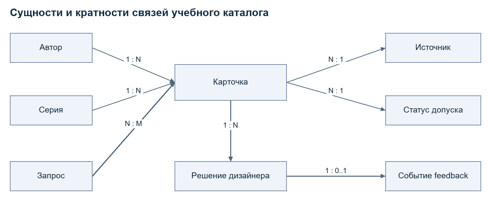

Один автор создаёт много карточек. Одна серия объединяет несколько карточек. Каждая карточка имеет один источник в текущей схеме и один статус допуска. Один запрос возвращает несколько карточек; одна карточка может появиться в ответах на разные запросы. Дизайнер принимает отдельное решение по каждой просмотренной карточке.

Запрос → ранжирование → карточка → источник и допуск → решение дизайнера → событие обратной связи.

Правило K1: неизвестный допуск → скрыть из используемой выдачи → архивариус проверяет источник. Правило K2: словарь связывает «саксофон» с «джаз» только в рамках учебного каталога. Это не универсальное утверждение о музыке. Правило K3: исправление пользователя сохраняется отдельно и не меняет автоматически разметку или модель.
