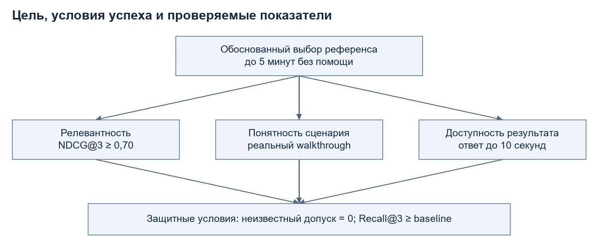

# Лабораторная работа 3

## Стейкхолдеры требования и критерии успеха

Методические указания по дисциплине «Проект — применение машинного обучения в креативных технологиях». Магистратура, второй курс, первый семестр курса (третий семестр обучения).

Связь с лекциями: Лекция 2. Компетенции и индикаторы: ПК-1, ПК-3.1.

## Цель

Перевести знания о домене в наблюдаемые требования, критерии приёмки и измеримые показатели результата.

## Исходная ситуация

В ассистенте редактора заказчик может ожидать сокращения времени подготовки черновика, а редактор — сохранения контроля, ссылок на источники и возможности правки.

Вход для работы: артефакты предыдущих работ, прежде всего ЛР 2. Результат включается в портфолио и используется на следующих шагах.

## Смысл работы

Требование описывает наблюдаемое поведение системы или ограничение. User story связывает действие с ролью и пользой. Критерий приёмки превращает пожелание в проверяемый сценарий. Например, «поиск удобен» нельзя однозначно принять, а «при пустой строке возвращается empty_query без случайных карточек» можно проверить автоматически.

RACI распределяет ответственность: R выполняет работу, A принимает итоговое решение, C консультирует, I получает информацию. Для каждого решения должен быть один A, иначе ответственность размывается. Трассировка связывает требование с источником знания и проверкой. Она помогает понять, какие тесты и документы надо изменить при пересмотре правила.

## Развёрнутый порядок выполнения

### Шаг 1 Ответственность

Обновите карту сторон после ЛР 2. Выделите решения о данных, правилах, выпуске результата и рисках. Заполните RACI по ролям, не по названиям файлов. Если команда мала, один человек может совмещать роли, но обязан различать техническое исполнение и содержательное согласование.

### Шаг 2 Пять пользовательских историй

Для каждой истории укажите роль, действие и причину. «Как дизайнер, хочу искать по описанию, чтобы не просматривать все папки» лучше, чем «использовать TF-IDF». История о выборе библиотеки является технической задачей и сама по себе не выражает пользовательскую ценность.

### Шаг 3 Критерии приёмки

Сформулируйте по 2–3 проверки для каждой истории. Используйте нормальный случай, границу или ошибку. Укажите вход, ожидаемое поведение и способ проверки. Не требуйте одинаковых численных оценок сходства в разных моделях, если достаточно проверить порядок и состав результата.

### Шаг 4 Классификация требований

Функциональные требования описывают действия, нефункциональные — ограничения времени, ресурсов и воспроизводимости. Требования к данным и ответственному применению задают правила допуска, отображения источников и роли человека. Одно требование может относиться к нескольким группам, но должно иметь один идентификатор.

### Шаг 5 Показатели и условия отказа

Разделите показатели пользы и метрики компонента. Задайте порог, условия измерения и ответственного. Для времени ответа укажите устройство и состав измерения; для времени выбора — сценарий сессии. Решение «гипотеза не подтверждена» заранее включите в протокол, чтобы отрицательный результат был допустим.

### Шаг 6 Трассировка

Для каждого важного требования добавьте источник K из ЛР 2, проверку T и путь к артефакту. Пройдите по цепочке в обе стороны: требование без проверки нельзя принять, тест без требования может проверять ненужное поведение. Передайте этот комплект в ЛР 7–8 как основание оценки.

## Полный демонстрационный вариант

### Артефакт RACI

| Решение | Дизайнер | Архивариус | Разработчик | Руководитель |
|---|---|---|---|---|
| Допуск данных | C | A/R | R | I |
| Словарь и критерии релевантности | A | C | R | I |
| Технический выпуск alpha | C | C | R | A |
| Разрешение спорной карточки | C | A/R | I | I |
| Подтверждение полезности сценария | R | C | C | A |

Совмещение A/R допустимо для одного ответственного. У каждой строки ровно один A. Учебные роли не означают назначения конкретных сотрудников студии.

### Артефакт Пять историй и критерии

| ID и история | Проверка 1 | Проверка 2 |
|---|---|---|
| R1 Дизайнер ищет по описанию, чтобы получить кандидатов | «джаз минимализм» возвращает не более 3 карточек и статус ok | Для отсутствующих слов результат no_matches, список пуст |
| R2 Дизайнер видит источник, чтобы проверить происхождение | У каждой карточки есть source и rights_status | Нет source — карточка не считается готовой к приёмке |
| R3 Архивариус ограничивает выдачу, чтобы исключить сомнительные материалы | Карточка со статусом unknown не попадает в результаты | Проверка прав выполняется и при fallback |
| R4 Дизайнер исправляет стиль, чтобы сообщить об ошибке | correct создаёт pending_review | Исходная модель и clean.json после события не меняются |
| R5 Дизайнер понимает сбой, чтобы выбрать следующий шаг | При пустом вводе HTTP 400 и empty_query | При отказе улучшения ответ помечен fallback |

Приёмочные проверки реализуются через demo.test_project и примеры запросов из ЛР 11–13. Скорость выбора проверяется отдельно с пользователем.

### Артефакт Перечень требований и дерево показателей

Функциональные: R1 поиск; R2 показ источника; R4 обратная связь; R5 сообщение об ошибке. Ограничение ответственного применения: R3 допуск материалов и окончательное решение человека. Нефункциональные: локальный запуск без API-ключа, максимум 300 символов, воспроизводимая обработка, явный статус отказа.

Пользовательская цель: обоснованный выбор первого референса за 5 минут при отсутствии помощи модератора. Владелец проверки — роль дизайнера совместно с исследователем. Этот порог остаётся гипотезой до ЛР 15. Дополнительный ориентир — время ответа до 10 секунд; измерять на указанной машине от отправки запроса до получения ответа, а не приписывать это значение результатам демо.

Техническая цель: NDCG@3 на validation не ниже 0,70. Защитные условия: Recall@3 не ниже baseline, число выданных карточек с неизвестным допуском равно нулю. Отдельно проверяется корректность ошибок API. При нарушении допуска выпуск запрещается независимо от NDCG. Если основная метрика не достигает порога, выбранная гипотеза качества не подтверждена.

Связь показателей: пользовательский выбор зависит от релевантности, полноты информации карточки и понятности интерфейса. NDCG проверяет только первую часть. Не допускается вывод «NDCG выросла, следовательно дизайнер работает быстрее» без пользовательского исследования.

### Артефакт Трассировка

| Требование | Источник знания | Проверка | Артефакт |
|---|---|---|---|
| R1 Поиск | K2, гипотеза о словах | T1 нормальный и синонимический запросы | demo/results/api_examples.json |
| R2 Источник | K1 | T2 проверка полей карточки | контракт ЛР 11 |
| R3 Допуск | K1 | test_rights_filter_defense | demo/test_project.py |
| R4 Исправление | K3 | test_feedback_does_not_train | demo/results/feedback_examples.json |
| R5 Ошибки | Граница alpha из ЛР 1 | test_invalid_input и test_fallback_visible | demo/test_project.py |

Результат ЛР 3 — спецификация. Факт реализации подтверждается в последующих работах. Это различие нужно сохранить в отчёте: наличие требования ещё не означает прохождение теста.

## Что сдать

RACI; backlog user stories; таблица трассировки; перечень требований; дерево показателей успеха и критерий отказа.

Пути ниже указаны относительно папки demo данной ЛР, если не приведён полный адрес.

| Требуемый материал | Где находится выполненный образец |
|---|---|
| RACI | raci.md |
| Backlog историй | user_stories.md |
| Трассировка | traceability.md |
| Перечень требований | requirements.md |
| Дерево показателей и критерий отказа | requirements.md |

## Критерии приёмки

Требования описывают результат для роли, а не техническую реализацию; у каждого важного требования есть источник и проверка; продуктовые показатели не смешаны с метриками модели.

| Критерий | Свидетельство в демо |
|---|---|
| Требования описывают результат для роли, а не техническую реализацию | Истории R1–R5 содержат роль, действие и пользу |
| у каждого важного требования есть источник и проверка | Трассировка связывает источник, проверку и файл |
| продуктовые показатели не смешаны с метриками модели | Раздельные продуктовые и технические показатели |

## Типичные ошибки

User story «как разработчик, хочу использовать LLM»; критерий «должно быть удобно»; KPI без владельца и порога; игнорирование интересов автора контента.

## Самопроверка перед сдачей

Как отличить критерий приёмки пользовательского сценария от метрики качества модели?

На индивидуальной защите объясните одно своё решение, покажите его артефакт и назовите ограничение. Учебный демо-вариант служит образцом оформления; собственный проект требует собственных данных, решений и подтверждённого вклада.

## Материалы и источники

https://github.com/Irina-64/ml-creative-technologies-course/tree/main/labs/03

Исходное задание сохранено в source_prompts/03.md. Формулировки компетенций приведены в COURSE_BASIS.md.

## Исходные шесть требований к выполнению

1. Обновите карту стейкхолдеров и подготовьте RACI для ключевых решений: данные, правила, выпуск результата, проверка рисков.

2. Сформулируйте минимум пять user stories в формате «как [роль], я хочу [действие], чтобы [ценность]».

3. Для каждой истории задайте 2–3 проверяемых критерия приёмки и способ проверки.

4. Разделите требования на функциональные, нефункциональные и этические/правовые.

5. Задайте продуктовые показатели успеха и отдельно технические метрики; определите порог, при котором гипотеза считается не подтверждённой.

6. Соберите трассировку «требование — источник знания — проверка — артефакт проекта».
