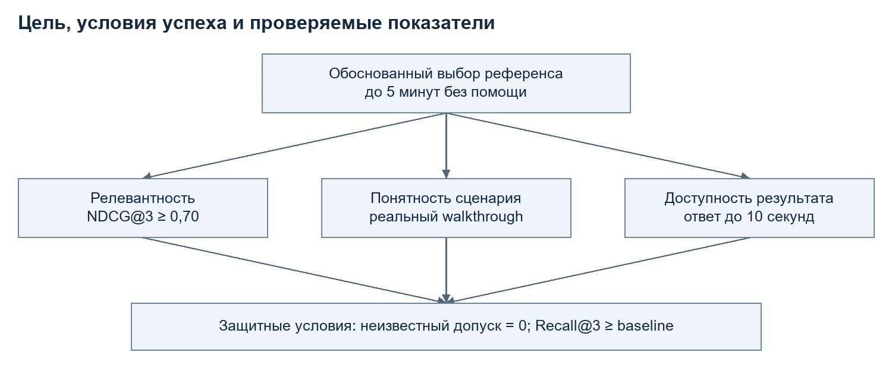

Функциональные: R1 поиск; R2 показ источника; R4 обратная связь; R5 сообщение об ошибке. Ограничение ответственного применения: R3 допуск материалов и окончательное решение человека. Нефункциональные: локальный запуск без API-ключа, максимум 300 символов, воспроизводимая обработка, явный статус отказа.

Пользовательская цель: обоснованный выбор первого референса за 5 минут при отсутствии помощи модератора. Владелец проверки — роль дизайнера совместно с исследователем. Этот порог остаётся гипотезой до ЛР 15. Дополнительный ориентир — время ответа до 10 секунд; измерять на указанной машине от отправки запроса до получения ответа, а не приписывать это значение результатам демо.

Техническая цель: NDCG@3 на validation не ниже 0,70. Защитные условия: Recall@3 не ниже baseline, число выданных карточек с неизвестным допуском равно нулю. Отдельно проверяется корректность ошибок API. При нарушении допуска выпуск запрещается независимо от NDCG. Если основная метрика не достигает порога, выбранная гипотеза качества не подтверждена.

Связь показателей: пользовательский выбор зависит от релевантности, полноты информации карточки и понятности интерфейса. NDCG проверяет только первую часть. Не допускается вывод «NDCG выросла, следовательно дизайнер работает быстрее» без пользовательского исследования.
