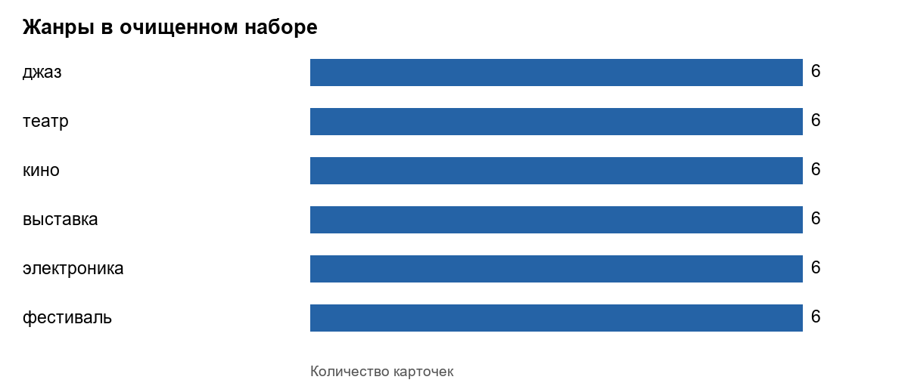
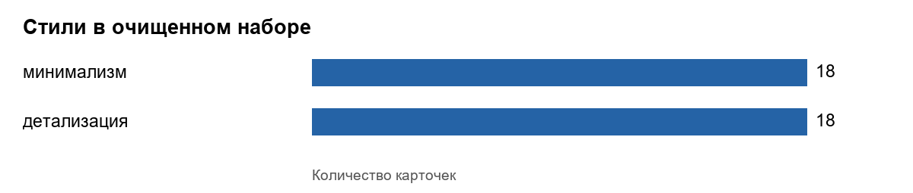
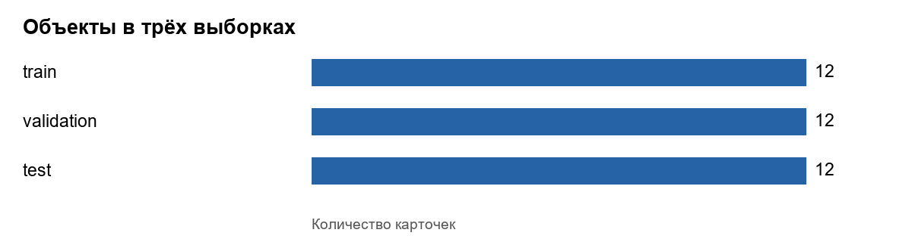
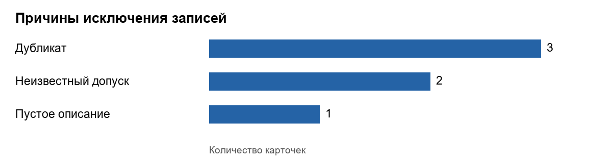
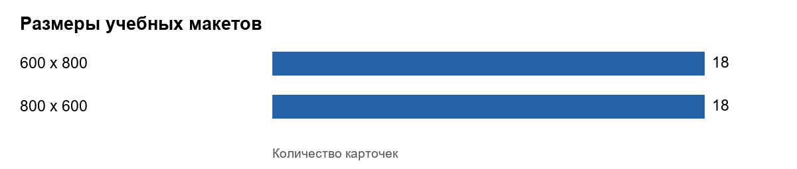
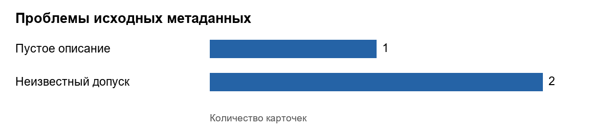

# Лабораторная работа 5

## Разведочный анализ и проверка качества данных

Методические указания по дисциплине «Проект — применение машинного обучения в креативных технологиях». Магистратура, второй курс, первый семестр курса (третий семестр обучения).

Связь с лекциями: Лекция 3. Компетенции и индикаторы: ПК-1.1.

## Цель

Проверить ключевые предположения о данных и найти риски, которые исказят обучение или оценку.

## Исходная ситуация

При анализе плакатов полезно проверить распределение жанров, разрешений, языков, дубликатов и метаданных. Водяной знак или имя автора могут стать ложным признаком вместо содержания изображения.

Вход для работы: артефакты предыдущих работ, прежде всего ЛР 4. Результат включается в портфолио и используется на следующих шагах.

## Что исследует EDA

Разведочный анализ данных, или EDA, связывает устройство набора с решениями проекта. График нужен для ответа на вопрос: достаточно ли данных нужного жанра, где возникают пропуски, не совпадают ли группы между выборками? Визуализация без интерпретации не позволяет решить, как готовить данные и оценивать модель.

Proxy-признак косвенно выдаёт целевую метку. Например, жанр может быть зашит в имени папки, а качество изображения — совпадать с источником. Модель научится распознавать такую подсказку и провалится на новом архиве. В нашем генераторе ориентация изображения связана со стилем; это намеренно простая конструкция, которую надо назвать ограничением.

## Развёрнутый порядок выполнения

### Шаг 1 Вопросы анализа

До построения графиков сформулируйте 5–8 вопросов и действие, которое зависит от ответа. Вопрос «какое распределение жанров?» полезен, если при дефиците театральных афиш вы ограничите выводы или измените сбор. Сохраните вопросы вместе с анализом, чтобы избежать декоративного набора диаграмм.

### Шаг 2 Проверки качества

Проверьте число записей, обязательные поля, повторы идентификаторов и содержимого, размеры, допустимые значения и пересечение групп. Отличайте дубликат записи от похожей композиции: хеш обнаруживает точное совпадение файлов, но не смысловое сходство. Не удаляйте объекты вручную без журнала причины и версии.

### Шаг 3 Шесть визуализаций

Для каждой фигуры укажите единицу счёта, выборку и интерпретацию. Доли raw и clean не смешивайте на одном графике без подписей. В демо используются простые столбчатые диаграммы с числом карточек; студент может добавить анализ языков, времени и авторов, если это соответствует проекту.

### Шаг 4 Просмотр медиа

Откройте типичные и проблемные объекты. Числовая таблица не показывает, что текст обрезан или композиция не соответствует описанию. Для демо сопоставьте P001 и P002, затем D001 и P001, а также X001 и X003 в raw. Объясните, почему проблема относится к данным, а не к качеству ранжирования.

### Шаг 5 Проверка утечек

Перечислите поля, потенциально раскрывающие жанр или стиль. Убедитесь, что модель использует только явно разрешённые признаки. Проверьте группы авторов и хеши после очистки. При обнаружении пересечения пересоберите split и не сравнивайте новую оценку со старой как будто данные не менялись.

### Шаг 6 Обновление паспорта

Запишите, какие проверки пройдены, что исключено и какие ограничения остались. В Data Card добавьте итоговый объём и версию, а в репозиторий — запускаемый скрипт и графики. Преподаватель должен получить тот же результат после повторного запуска.


## Полный демонстрационный вариант

### Артефакт Воспроизводимый анализ

Из корня репозитория выполните:

```powershell
python -m demo.project run
python -m demo.eda
```

Первая команда создаёт данные и результаты, вторая — шесть SVG-графиков. Код анализа целиком находится в `demo/eda.py`, исходные записи — в `demo/data/raw.json`. Скрипт не скачивает данные и использует стандартную библиотеку Python. Повторный запуск перезаписывает только генерируемые файлы демо.

Вопросы: представлены ли все шесть жанров; сбалансированы ли стили; равны ли объёмы split; по каким причинам исключены записи; связаны ли размеры со стилем; где отсутствуют обязательные метаданные? Седьмая проверка выполняется тестом: нет ли пересечения авторов и хешей.


### Артефакт Шесть графиков с интерпретациями



Шесть жанров имеют по 6 карточек. Решение: не применять веса классов к этому учебному набору. Ограничение: баланс искусственный, поэтому по нему нельзя судить о составе реальной коллекции.



Два стиля имеют по 18 карточек. Решение: анализировать оба стиля отдельно. Одинаковая частота не гарантирует, что определение стиля хорошо работает на произведениях дизайнеров.



В каждой части 12 карточек. Решение: сохранить групповое разделение и дополнительно проверить группы. Равенство количества само по себе не исключает утечку.



Исключены три точных дубля, две записи с неизвестным допуском и одна с пустым описанием. После очистки 42 − 3 − 2 − 1 = 36. Каждая запись получает одну причину согласно порядку проверок.



По 18 портретных и альбомных макетов. Ориентация совпадает со стилем генератора. Решение: не использовать её как доказательство художественного стиля; в реальных данных проверить независимость источника и метки.



У одной исходной записи пустое описание, у двух неизвестный допуск. Решение: исключить до уточнения, не заменять неизвестный статус разрешённым.

### Артефакт Таблица качества и просмотр примеров

| Проверка | Фактический результат | Решение |
|---|---|---|
| Объём raw и clean | 42 и 36 | Зафиксировать версию 1.0 |
| Повтор хеша в clean | 0 | Пригодно для следующего шага |
| Пересечение авторов | 0 | Групповой split сохранён |
| Неизвестный допуск в clean | 0 | Фильтр обязателен и в API |
| P001 и P002 | 2 и 7 геометрических объектов | Типичные представители двух учебных классов |
| D001 и P001 | Один хеш изображения | D001 исключить как точный дубль |
| X001 | Изображение есть, статус unknown | Не включать в рабочую выдачу |
| X003 | Изображение есть, description пусто | Исключить из текстового поиска |

Медиа-примеры открываются по полю image соответствующей записи. D001, X001 и X003 ссылаются на существующие учебные изображения; специально испорчены записи метаданных, а не содержание SVG.


### Артефакт Обновление Data Card

Версия 1.0 после очистки: 36 карточек, 6 жанров, 2 стиля, 6 вымышленных авторских групп. Журнал исключений: demo/results/exclusions.csv. Проверки: demo/results/quality_checks.csv. Неразрешённые записи не попадают в clean.

Оставшиеся ограничения: искусственные описания, отсутствие естественных языковых вариаций за пределами словаря, связь размера со стилем, отсутствие настоящей экспертной оценки. Следующее решение: провести пилот инструкции разметки и проверить согласие на специально подготовленном примере ЛР 6.


## Что сдать

Воспроизводимый notebook или скрипт; 5–8 содержательных визуализаций; таблица проверок качества; обновлённая Data Card.

Пути ниже указаны относительно папки demo данной ЛР, если не приведён полный адрес.

| Требуемый материал | Где находится выполненный образец |
|---|---|
| Воспроизводимый скрипт | ../../../demo/eda.py |
| Шесть визуализаций | ../../../demo/results/figures |
| Таблица качества | quality_review.md |
| Обновлённая Data Card | data_card_update.md |

## Критерии приёмки

Код запускается из репозитория; все графики имеют подписи и интерпретацию; найденные проблемы влияют на дальнейший план; выборка примеров не скрывает неудобные случаи.

| Критерий | Свидетельство в демо |
|---|---|
| Код запускается из репозитория | Две команды и полный скрипт EDA |
| все графики имеют подписи и интерпретацию | Шесть подписанных графиков и выводы |
| найденные проблемы влияют на дальнейший план | Решения об исключении и ограничении признаков |
| выборка примеров не скрывает неудобные случаи | Открыто показаны D001, X001, X003 |

## Типичные ошибки

Декоративные графики без вопроса; ручное удаление данных без журнала; вывод о качестве по нескольким удачным изображениям; отсутствие проверки повторов между split.

## Самопроверка перед сдачей

Какая визуализация изменила бы ваше решение о модели или данных, если бы показала неожиданный результат?

На индивидуальной защите объясните одно своё решение, покажите его артефакт и назовите ограничение. Учебный демо-вариант служит образцом оформления; собственный проект требует собственных данных, решений и подтверждённого вклада.

## Материалы и источники

https://github.com/Irina-64/ml-creative-technologies-course/tree/main/labs/05

Исходное задание сохранено в source_prompts/05.md. Формулировки компетенций приведены в COURSE_BASIS.md.

## Исходные шесть требований к выполнению

1. Сформулируйте 5–8 вопросов EDA, непосредственно связанных с проектными решениями.

2. Проверьте объём, пропуски, дубликаты, распределение классов, выбросы и согласованность форматов.

3. Визуализируйте данные так, чтобы по каждой визуализации можно было сделать решение или сформулировать риск.

4. Покажите репрезентативные и проблемные медиа-примеры с кратким объяснением их значения.

5. Проверьте возможные proxy-признаки и утечки: имена файлов, серии кадров, метаданные, повторяющиеся авторы.

6. Обновите Data Card и внесите список data-quality checks в репозиторий.
