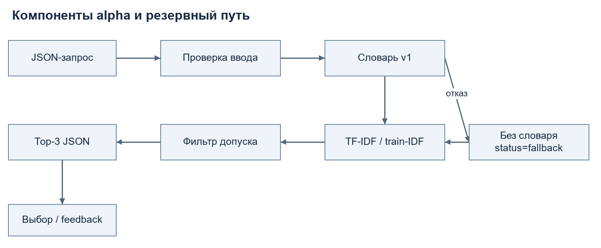

# Лабораторная работа 10

## Выбор архитектуры и инструментов

Методические указания по дисциплине «Проект — применение машинного обучения в креативных технологиях». Магистратура, второй курс, первый семестр курса (третий семестр обучения).

Связь с лекциями: Лекции 5–6. Компетенции и индикаторы: ПК-1, ПК-1.1.

## Цель

Принять и обосновать архитектурное решение с учётом качества, данных, ресурсов, лицензий и рисков.

## Исходная ситуация

Для музейного ассистента можно сопоставить поиск по ключевым словам, embeddings + retrieval, готовый API и RAG. Технология выбирается не по моде, а по способности дать проверяемый результат в заданных границах.

Вход для работы: артефакты предыдущих работ, прежде всего ЛР 9. Результат включается в портфолио и используется на следующих шагах.

## Архитектурное решение как проверяемый выбор

Архитектура определяет компоненты, обмен данными, ответственность и поведение при отказе. Перечень библиотек не показывает, где проверяются права, как пользователь получает результат и что произойдёт при недоступности компонента. Решение должно отвечать требованиям ЛР 3 и учитывать результаты ЛР 9.

Сначала проверяются обязательные ограничения, затем сравниваются допустимые варианты. Запрет передачи закрытого архива во внешний сервис нельзя компенсировать высокой оценкой удобства. Неизвестную стоимость или качество следует обозначать неизвестными, а не заполнять выдуманными числами ради полной таблицы.

## Развёрнутый порядок выполнения

### Шаг 1 Архитектурный вопрос

Сформулируйте решение, которое действительно нужно принять сейчас. Для alpha это способ локального поиска с отображением источников и резервным режимом. Для музейного ассистента вопросом может быть способ проверки фактических утверждений перед показом посетителю.

### Шаг 2 Три альтернативы

Сравните минимум три варианта на одном сценарии и объёме. Включите простое решение. Не сравнивайте локальный поиск по 36 карточкам и промышленную генеративную систему как будто они решают одинаковую задачу при одинаковых ресурсах.

### Шаг 3 Критерии

Разделите обязательные условия и предпочтения. К первым относятся допустимость данных, локальность и сохранение решения человека. Ко вторым — ожидаемое качество, сложность, скорость разработки и объяснимость. Для шкалы укажите смысл каждого балла.

### Шаг 4 Оценка и основания

Для измеренных значений ссылайтесь на результаты эксперимента. Для экспертных порядковых оценок пишите «учебная оценка команды» и допущение. Не приписывайте нейросетевой альтернативе высокую NDCG без запуска.

### Шаг 5 Схема компонентов

Покажите вход, валидацию, модель, слой знаний, фильтрацию, выдачу, решение человека и журнал. Для каждого перехода поясните передаваемые поля. Отдельно изобразите резервный путь и ошибку, чтобы не скрыть их внутри названия компонента.

### Шаг 6 Инструменты и решение

Зафиксируйте фактическую версию интерпретатора и роль каждого средства. Укажите способ запуска без платного API. Запишите предпосылку, при изменении которой решение нужно пересмотреть, например рост архива или необходимость поиска по самому изображению.

## Полный демонстрационный вариант

### Артефакт Матрица выбора

Архитектурный вопрос: как реализовать воспроизводимый поиск в локальном учебном каталоге с сохранением авторского выбора? Обязательные условия: локальный запуск, отсутствие API-ключей, вывод источника и фильтр допуска.

| Критерий | TF-IDF | TF-IDF и словарь | Нейросетевой локальный индекс |
|---|---|---|---|
| Локальность | Да | Да | Возможна, модель ещё не выбрана |
| Измеренная validation NDCG@3 | 0,50 | 1,00 | Не измерена |
| Подготовка данных | Описания | Описания и словарь | Описания или изображения и модель |
| Сложность поддержки, 1–3 | 1 | 2 | 3, предварительная оценка |
| Объяснимость, 1–3 | 3 | 3 | 1, предварительная оценка |
| Зависимость от внешнего API | Нет | Нет | Нет при локальной модели |
| Неизвестные | Естественные запросы | Полнота и ошибки словаря | Ресурсы, права модели, качество |

Шкала сложности: 1 — один простой модуль; 2 — дополнительный проверяемый словарь; 3 — отдельная модель и индекс. Шкала объяснимости: 3 — можно показать слова и правило; 1 — потребуется отдельное объяснение сходства. Это оценки учебного решения, не универсальный рейтинг технологий.

### Артефакт Архитектурная схема

Запрос JSON → проверка типа и длины → нормализация по lexicon.json → TF-IDF с train-IDF → косинусное ранжирование → фильтр demo_allowed → top-3 JSON → решение дизайнера.

Резервный путь: контролируемый отказ улучшения → тот же TF-IDF без словаря → status=fallback. Если совпадений нет, возвращается no_matches. Некорректный ввод даёт HTTP 400. Обратная связь идёт отдельным путём: событие → runtime/feedback.json → проверка ответственным → возможная новая версия данных. Автоматического переобучения нет.

Данные между компонентами: query — строка; кандидат — id и score; карточка ответа — id, genre, style, source, rights_status, image; обратная связь — record_id, action, actor, proposed_style и status. Каталог и параметры модели загружаются локально при запуске.

### Артефакт Инструменты и принятое решение

ADR-01, версия 1.0. Выбран TF-IDF со словарём: он выполнил условия учебного эксперимента и объясним начинающим студентам. Python 3.10+ реализует вычисления; фактическая версия записана в demo/results/environment.json. JSON хранит конфигурацию и каталог, CSV — результаты. Модуль http.server используется только для локального учебного API, не как промышленный сервер.

Внешние модели, платные API и GPU не нужны. Plan B — baseline без словаря и просмотр исходных карточек. Прямые расходы на внешние запросы в этом варианте отсутствуют; стоимость труда и оборудования не измерялась.

Предпосылки: малый каталог, короткие русскоязычные описания, ограниченный словарь. При необходимости искать по изображению, обрабатывать новые языки или большой архив решение пересматривается. Сначала выполняется отдельный эксперимент с альтернативой; высокая сложность не считается доказательством лучшего качества.

## Что сдать

Матрица выбора; архитектурная схема; перечень инструментов и ролей; решение с обоснованием и перечнем допущений.

Пути ниже указаны относительно папки demo данной ЛР, если не приведён полный адрес.

| Требуемый материал | Где находится выполненный образец |
|---|---|
| Матрица выбора | architecture_matrix.md |
| Архитектурная схема | architecture.md |
| Инструменты и роли | architecture_decision.md |
| Решение и допущения | architecture_decision.md |

## Критерии приёмки

Архитектура отвечает требованиям и ограничениям; решение проверяемо; альтернативы сопоставимы; указаны зависимость от внешних сервисов и plan B.

| Критерий | Свидетельство в демо |
|---|---|
| Архитектура отвечает требованиям и ограничениям | Обязательные ограничения и связь с R |
| решение проверяемо | Измеренные оценки отделены от допущений |
| альтернативы сопоставимы | Один сценарий для трёх альтернатив |
| указаны зависимость от внешних сервисов и plan B | Локальность и baseline как plan B |

## Типичные ошибки

Единственная альтернатива; оценки без оснований; схема только из названий библиотек; игнорирование стоимости и прав на модели/данные.

## Самопроверка перед сдачей

Какая предпосылка выбора наиболее рискованна и как alpha-версия позволит её проверить?

На индивидуальной защите объясните одно своё решение, покажите его артефакт и назовите ограничение. Учебный демо-вариант служит образцом оформления; собственный проект требует собственных данных, решений и подтверждённого вклада.

## Материалы и источники

https://github.com/Irina-64/ml-creative-technologies-course/tree/main/labs/10

Исходное задание сохранено в source_prompts/10.md. Формулировки компетенций приведены в COURSE_BASIS.md.

TF-IDF и текстовые признаки: https://scikit-learn.org/stable/modules/feature_extraction.html. Метрики ранжирования: https://scikit-learn.org/stable/modules/generated/sklearn.metrics.ndcg_score.html. В демо явно задан экспоненциальный gain; библиотечные соглашения могут отличаться.

## Исходные шесть требований к выполнению

1. Сформулируйте архитектурный вопрос, который должен быть решён до реализации alpha-версии.

2. Сравните минимум три релевантные альтернативы; среди них допустим мотивированный отказ от сложной технологии.

3. Определите критерии матрицы: ожидаемое качество, требования к данным, задержка, стоимость, лицензия, объяснимость, поддерживаемость, риски.

4. Оцените каждую альтернативу по единой шкале, укажите источники оценок и допущения.

5. Постройте схему выбранной архитектуры: вход, обработка, знания/модель, выход, журналирование, человек и fallback.

6. Зафиксируйте инструменты, версию и роль каждого; определите, что будет сделано без внешнего платного API.
