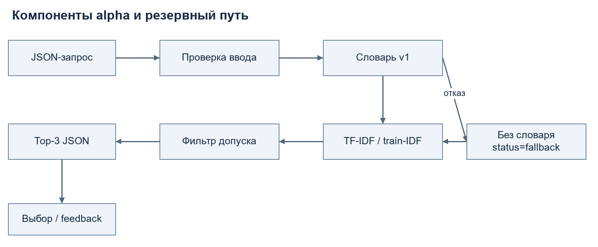

Запрос JSON → проверка типа и длины → нормализация по lexicon.json → TF-IDF с train-IDF → косинусное ранжирование → фильтр demo_allowed → top-3 JSON → решение дизайнера.

Резервный путь: контролируемый отказ улучшения → тот же TF-IDF без словаря → status=fallback. Если совпадений нет, возвращается no_matches. Некорректный ввод даёт HTTP 400. Обратная связь идёт отдельным путём: событие → runtime/feedback.json → проверка ответственным → возможная новая версия данных. Автоматического переобучения нет.

Данные между компонентами: query — строка; кандидат — id и score; карточка ответа — id, genre, style, source, rights_status, image; обратная связь — record_id, action, actor, proposed_style и status. Каталог и параметры модели загружаются локально при запуске.
