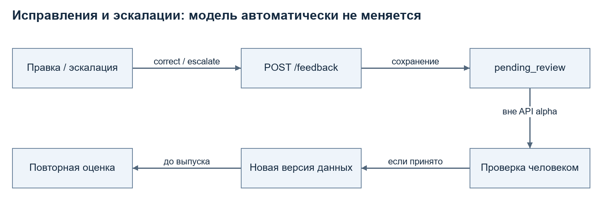

# Лабораторная работа 12

## Интеграция знаний и human-in-the-loop

Методические указания по дисциплине «Проект — применение машинного обучения в креативных технологиях». Магистратура, второй курс, первый семестр курса (третий семестр обучения).

Связь с лекциями: Лекции 6–7. Компетенции и индикаторы: ПК-1, ПК-3.

## Цель

Связать модель с предметными знаниями и обеспечить осмысленный контроль пользователя над результатом.

## Исходная ситуация

В сервисе для редактора retrieval подаёт проверенные записи из архива, а редактор подтверждает, корректирует или отклоняет черновик. Простая кнопка «нравится» не заменяет такого контроля.

Вход для работы: артефакты предыдущих работ, прежде всего ЛР 11. Результат включается в портфолио и используется на следующих шагах.

## Знания и решение человека

Слой знаний может быть словарём, таксономией, правилами, графом или поиском по проверенным документам. Он должен иметь источник и явную роль в вычислении. В нашем проекте словарь меняет представление запроса, правило допуска фильтрует кандидатов, а обратная связь сохраняет решение дизайнера отдельно от обучающих данных.

Human-in-the-loop означает, что человек действительно влияет на результат или последующее решение. Кнопка «нравится» без дальнейшей обработки не обеспечивает контроль. Необходимо указать, кто исправляет, кто утверждает и как система ведёт себя до проверки. Автоматическое обучение на любой пользовательской правке может внести ошибки в данные.

## Развёрнутый порядок выполнения

### Шаг 1 Представление знаний

Выберите знания из ЛР 2, необходимые именно вашему сценарию. Укажите формат, версию и место применения. Не называйте весь текст README базой знаний, если алгоритм его не использует. В демо применяется mapping из lexicon.json и явное условие rights_status в коде поиска.

### Шаг 2 Поток решений

Покажите, как запрос превращается в результат и где проверяются источники, допуск и ограничения. Обозначьте место записи обратной связи и отдельно процесс её проверки. По схеме должно быть понятно, какие данные изменяются немедленно, а какие остаются прежними.

### Шаг 3 Полномочия человека

Определите действие дизайнера и действие архивариуса. Дизайнер может выбрать, отвергнуть и предложить правку. Проверка допуска относится к ответственной роли. В учебном локальном API роль передаётся строкой; это демонстрация логики, не настоящая аутентификация и не защита полномочий.

### Шаг 4 Интерфейс или API

Покажите поля, через которые пользователь видит источник и статус. Добавьте ответ на действие человека. Если полный интерфейс не реализован, предоставьте контракт API и последовательность вызовов; исходное задание допускает такой вариант.

### Шаг 5 Исправление и отказ

Продемонстрируйте два случая: предложение исправить стиль и передачу сомнительной карточки на проверку. Покажите вход, ответ и состояние данных после действия. Отказ должен быть объяснимым, а не скрываться за пустым экраном.

### Шаг 6 Журнал и защита данных

Сохраняйте ID объекта, действие, роль, предложенное значение и статус проверки. Не пишите в журнал лишние персональные данные или секреты. Принятые изменения включайте в новую версию данных после проверки, а не в текущую модель автоматически.


## Полный демонстрационный вариант

### Артефакт Слой знаний

Версия словаря 1.0 хранится в demo/data/lexicon.json. Например, «спектакль» заменяется на «театр», «лаконичный» — на «минимализм». Источник — явно обозначенный учебный глоссарий ЛР 2. Применимость ограничена этим каталогом. Правило допуска реализовано в SearchEngine.search: строка с rights_status, отличным от demo_allowed, не выдаётся.

Связь с происхождением: K2 обосновывает словарь, K1 — фильтр допуска, K3 — самостоятельный выбор. Ограничение: соответствия слов являются упрощением, поэтому для реальных запросов нужны экспертная проверка и журнал исключений.


### Артефакт Поток и контракт обратной связи



Поток: query → словарь → модель → фильтр допуска → карточки с source → действие дизайнера → runtime/feedback.json → рассмотрение ответственным → новая версия данных при принятии.

POST /feedback принимает record_id, action, actor и, для correct, proposed_style. Действия: select, reject, correct, escalate. Учебные роли: designer_demo и archivist_demo. Исправление и эскалация получают pending_review; выбор и отказ — recorded. Поле model_updated всегда false.

В настоящей системе роль должна определяться проверенной учётной записью. Здесь строка actor используется только для демонстрации маршрута решения, поэтому сервис запускается локально. Утверждение правки архивариусом описано как следующий процедурный шаг и в API 1.0 не реализовано; это открытое ограничение alpha.


### Артефакт Два примера действий

Пример 1 — пользователь считает стиль P003 неверным:

```json
{"record_id":"P003", "action":"correct",
 "actor":"designer_demo", "proposed_style":"детализация"}
```

Ответ содержит status=pending_review, model_updated=false. Исходный style карточки остаётся минимализмом. В данном примере предложенная правка не соответствует правилу генератора, поэтому её нельзя автоматически принять. Случай специально показывает, почему требуется проверка человеком.

Пример 2 — пользователь сомневается в данных P004:

```json
{"record_id":"P004", "action":"escalate", "actor":"designer_demo"}
```

Ответ: pending_review, proposed_style=null, model_updated=false. Карточка не получает автоматически новый допуск. Проверка неизвестного статуса выполняется отдельным тестом: если P003 помечена unknown, она исчезает из выдачи независимо от высокой оценки сходства.

Полные примеры ответов: demo/results/feedback_examples.json. Во время серверной сессии события фактически сохраняются в demo/runtime/feedback.json. Каталог clean.json не изменяется.


### Артефакт Правила дальнейшего использования обратной связи

Ответственный рассматривает событие, открывает исходный объект, проверяет инструкцию и указывает принять или отклонить с причиной. Только принятая правка включается в новую версию разметки; затем повторяются проверки split и метрик. Сырые события не используются как новые обучающие метки.

Открытые ограничения: отсутствие аутентификации, интерфейса утверждения и контроля параллельных правок. Для текущего однопользовательского учебного API это явно оговорённые границы, а не реализованные механизмы защиты.


## Что сдать

Схема потока; прототип интерфейса или API; описание слоя знаний; протокол обратной связи; примеры исправления и отказа.

Пути ниже указаны относительно папки demo данной ЛР, если не приведён полный адрес.

| Требуемый материал | Где находится выполненный образец |
|---|---|
| Схема потока | feedback_protocol.md |
| Прототип API | ../../../demo/server.py |
| Слой знаний | knowledge_layer.md |
| Протокол обратной связи | feedback_protocol.md |
| Исправление и отказ | correction_and_escalation.md |

## Критерии приёмки

Роль человека меняет результат или последующее решение; источники/правила прослеживаемы; система не маскирует отсутствие знания уверенным ответом.

| Критерий | Свидетельство в демо |
|---|---|
| Роль человека меняет результат или последующее решение | Выбор и правка создают события |
| источники/правила прослеживаемы | Версия словаря и происхождение K |
| система не маскирует отсутствие знания уверенным ответом | No_matches, pending_review и границы полномочий |

## Типичные ошибки

Human-in-the-loop только на слайде; retrieval без отображения источника; сбор обратной связи без назначения; автоматическое обучение на непроверенных исправлениях.

## Самопроверка перед сдачей

Где пользователь может заметить, что результат основан на предположении, а не на проверенном знании?

На индивидуальной защите объясните одно своё решение, покажите его артефакт и назовите ограничение. Учебный демо-вариант служит образцом оформления; собственный проект требует собственных данных, решений и подтверждённого вклада.

## Материалы и источники

https://github.com/Irina-64/ml-creative-technologies-course/tree/main/labs/12

Исходное задание сохранено в source_prompts/12.md. Формулировки компетенций приведены в COURSE_BASIS.md.

Документация локального HTTP-сервера Python: https://docs.python.org/3/library/http.server.html. Этот сервер предназначен здесь только для учебного запуска на localhost.

## Исходные шесть требований к выполнению

1. Выберите слой знаний: retrieval, правила, таксономию, словарь, граф сущностей или другое релевантное представление.

2. Опишите поток данных и решений: от запроса до результата, источников, статусов и журналирования.

3. Определите конкретную точку human-in-the-loop: кто, что и по каким критериям подтверждает, исправляет или отклоняет.

4. Реализуйте или спроектируйте интерфейс/API, который делает источники и ограничения результата видимыми.

5. Покажите минимум два случая: коррекция ошибки пользователем и отказ/эскалация при недостаточной уверенности.

6. Зафиксируйте, как обратная связь сохраняется и как она не должна автоматически ухудшить данные или модель.
