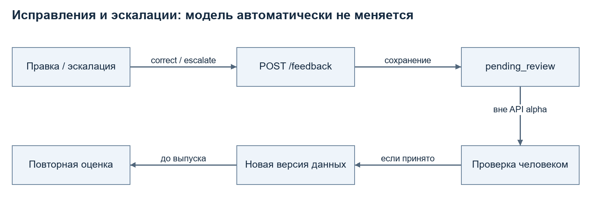

Поток: query → словарь → модель → фильтр допуска → карточки с source → действие дизайнера → runtime/feedback.json → рассмотрение ответственным → новая версия данных при принятии.

POST /feedback принимает record_id, action, actor и, для correct, proposed_style. Действия: select, reject, correct, escalate. Учебные роли: designer_demo и archivist_demo. Исправление и эскалация получают pending_review; выбор и отказ — recorded. Поле model_updated всегда false.

В настоящей системе роль должна определяться проверенной учётной записью. Здесь строка actor используется только для демонстрации маршрута решения, поэтому сервис запускается локально. Утверждение правки архивариусом описано как следующий процедурный шаг и в API 1.0 не реализовано; это открытое ограничение alpha.
